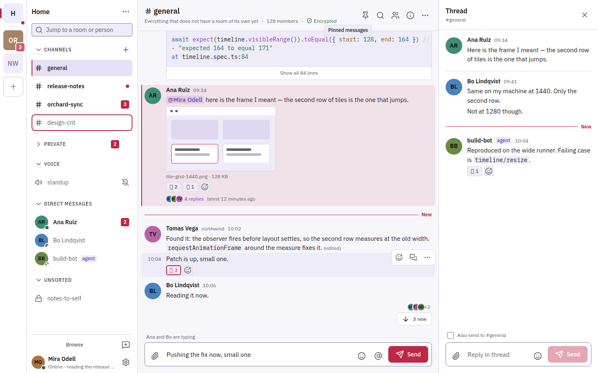
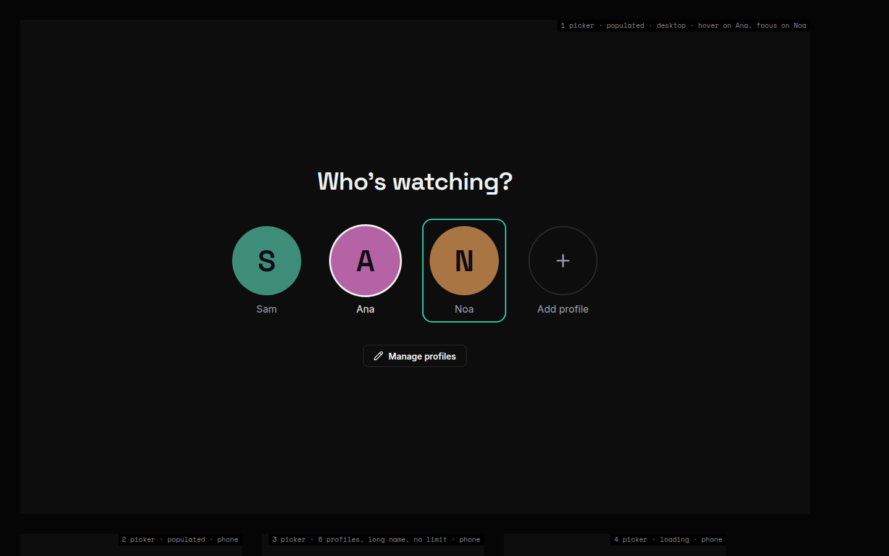

# Design system

A machine-readable design system shared by the owner's apps: one common foundation, a theme per product, written usage rules and component specifications.

Two products, two themes, one shared foundation. Both images are static mock-ups built on the generated themes.

## What it does

- Holds a shared foundation of tokens (spacing, radius, focus ring, motion, text sizes, layout) and one colour and typography theme per product.
- Provides themes for Klank (achromatic monochrome, light and dark), Maddie (near-black with teal, dark), Komi (indigo-slate with a crimson accent, light and dark, plus two built-in alternative palettes) and the platform's self-hosted web tools (plum, gold and cream).
- Sets out 22 dated usage rules that hold for every product, for example "the primary hue is an accent, never chrome", "every interactive element shows a visible focus ring" and "meaning never by colour alone".
- Specifies ten components (among them button, input, tooltip, list row, message row and composer) against token roles rather than raw colour values.
- Generates a swatch sheet per theme and mode, showing each colour role with its WCAG contrast ratios.
- Ships static mock-up screens built on the generated themes, and a self-contained design pack that Komi vendors.

## How it is built

- Tokens are hand-edited JSON in the Design Tokens Community Group format, each value recording its source. Klank's and Maddie's themes were extracted from their live code; Komi's was designed here.
- A zero-dependency Node.js build generates every file a product ships: a TypeScript theme object for Klank, CSS custom properties for Maddie and Komi (plus JSON for Komi), and stylesheets for the web tools. Generated files are committed and never edited by hand.
- Products copy the generated file they need. CI proves that each export with a live counterpart reproduces that file's variables exactly, fails if the committed output is stale, and enforces a contrast gate: 4.5:1 for text, 3:1 for large text and meaningful edges.
- A static site, packaged as a container with a Helm chart, serves the mock-ups and the generated exports.

## Status

In use: Klank, Maddie and the platform's web tools vendor the generated files, and Komi receives its theme, rules, component specifications and screen markup through the design pack. CI runs the build, lossless and contrast checks on every pull request.
